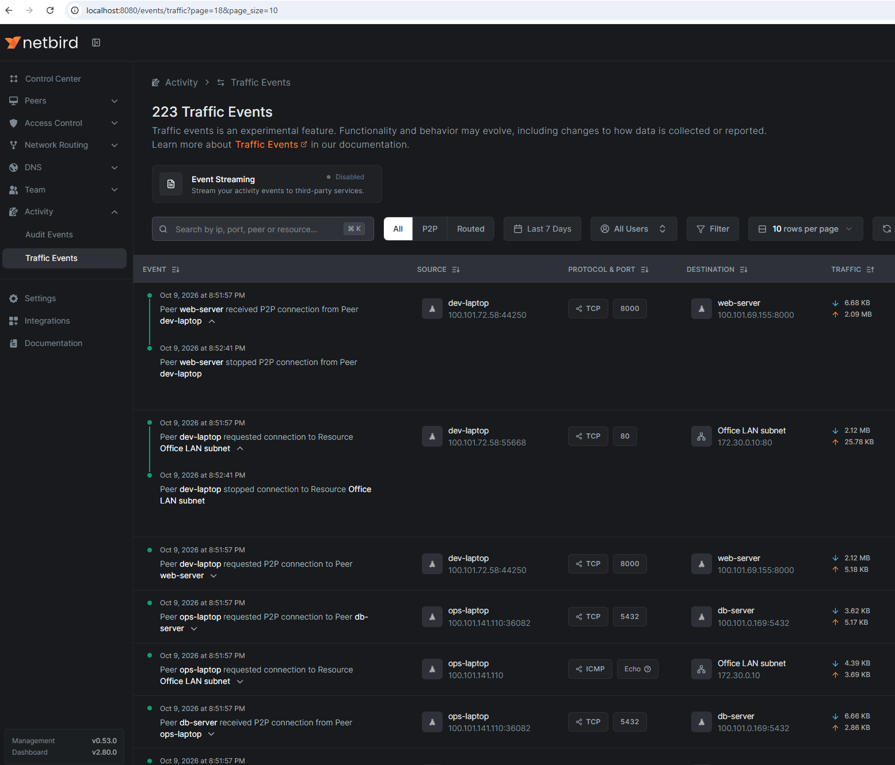

# Netbird-traffic-event-logger
This repo is a POC of a service, that can be used to retrive [Netbird Traffic Event logs](https://docs.netbird.io/how-to/traffic-events-logging )
which at the time of writing (2025-10-04 v0.53.0) is only available in the Netbird paid cloud.

The server.go file exposes a "Flow traffic event reciever" GRPC server on port 9000 that a Netbird
client can connect to and send traffic events to. 
The server can then store the events in a postgres database,
that then later can be used to correlate IDs from the events data to something meaningful:

- Timestamp: When the flow started and ended.
- Flow ID: A unique identifier for the traffic event flow.
- Type: The type of traffic event, such as Start, End, or Blocked.
- Source and Destination IP Addresses: The IP of the peer (source) and the IP of the remote endpoint (destination).
  For peer-to-peer traffic, these will be the NetBird network IPs 
  (e.g. 100.x.x.x addresses of each peer). For traffic to an external resource 
  (like a private server or subnet), the destination might be an IP in that remote network.
- Source and Destination Ports: The network ports used by the connection (for TCP/UDP flows).
- ICMP Code and Type: For ICMP traffic, the ICMP code and type.
- Protocol: The protocol of the traffic, such as TCP, UDP, or ICMP.
- Direction: Whether the flow was inbound or outbound. 
  This takes into consideration the perspective of the peer reporting the traffic and the NetBird interface.
- *Volume of Data*: The amount of data transferred, measured in number of packets and bytes
  sent/received for the duration of the flow.
- *Resource ID*: Network route or Networks resource ID that the flow is associated with.
  This is useful for identifying the routing configuration that allowed the flow. 
  DNS route information is available only on the routing client.
- *Rule ID*: The ID of the policy that allowed the flow. This is useful for identifying
  the access control policy that allowed the flow.
  This information is available only on the receiving side of the traffic.

The Resource ID and Rule ID could be used to correlate the traffic event with 
a specific network route and policy in the Netbird Dashboard. The relevant data could then be:
- Timestamp
- Source and Destination IP Addresses
- Source and Destination Ports 
- Type
- Volume of Data

## Traffic Events in the NetBird dashboard

With the [modified NetBird management service](https://github.com/ValarMarkhulis/netbird/tree/v0.53.0-traffic-event-logging-unlocked)
pointed at this project's database (`NB_NETWORK_TRAFFIC_POSTGRES_DSN`), management serves
`GET /api/events/network-traffic` from `event_logs`, and the stock dashboard's
**Activity → Traffic Events** page renders it. Peer-to-peer and routed (Networks resource)
flows are shown with their start and stop times, protocol, ports and traffic volume:




## Overall architecture

The system is composed of two independent programs that share the same PostgreSQL database.

```
NetBird clients
     │  gRPC (port 443 via Caddy / port 9000 direct)
     ▼
┌─────────────────────────────┐
│  flow server  (server.go)   │  ← always running, receives events in real time
│  - gRPC receiver            │
│  - worker pool + batching   │
│  - circuit breaker          │
│  - gRPC health endpoint     │
└──────────────┬──────────────┘
               │ writes raw flow events
               ▼
        ┌─────────────┐
        │  PostgreSQL  │
        │  event_logs  │
        │  sessions    │
        └──────┬───────┘
               │ reads events, writes sessions
               ▼
┌─────────────────────────────┐
│  ETL job  (go-etl/)         │  ← runs on a schedule (e.g. every 5 minutes)
│  - extract from DB          │
│  - filter / group / split   │
│  - upsert session records   │
└─────────────────────────────┘
```

**Flow server** — a long-running gRPC service. NetBird clients connect to it and stream flow events. The server writes every event to the `event_logs` table as fast as possible, using batched inserts and a worker pool.

**ETL job** — a long-running daemon that wakes up on a configurable interval (default every 5 minutes via `ETL_INTERVAL`). It uses an **incremental watermark** strategy: on each run it fetches only the events that arrived since the previous run, merges them into existing open session records, and advances the watermark. The first ever run processes all events as a bootstrapping step. This keeps each run O(new events) regardless of total history size.

Sessions have an `is_open` flag. An open session is one where the connection is still ongoing — new events are merged into it on subsequent runs. When the split threshold fires (a `TYPE_END` event carries a significant fraction of the session's cumulative traffic followed by a gap before the next `TYPE_START`), the session is closed and a new open one is started.

To handle connections that drop without a clean `TYPE_END` (e.g. network failure or process crash), the ETL automatically closes any session that has not been updated in **4 hours** at the end of every incremental run. This is a single SQL `UPDATE` and is effectively free during normal operation.

After each incremental run the ETL **prunes raw `event_logs` rows** older than the configured retention window (default 48 h). Once events have been aggregated into sessions they are no longer needed, so this keeps the database from growing unboundedly without losing any derived data.

The two components are deliberately decoupled: the flow server has no knowledge of sessions, and the ETL job has no knowledge of live gRPC connections. The database is the only shared state.

See [go-etl/README.md](go-etl/README.md) for full documentation of the ETL pipeline.

---

## Server architecture

The server (`server.go`) is designed to be stable and handle high volumes of traffic events reliably.

### Event pipeline

```
NetBird clients
     │  gRPC stream (port 9000)
     ▼
Events() handler          ← one goroutine per connected client
     │  chan (buffer: 10 000 events)
     ▼
Worker pool (4 goroutines) ← StartEventLogging / runBatchWorkers
     │  batch (up to 100 events, flushed every 500 ms)
     ▼
PostgreSQL
```

### Key components

**gRPC receiver (`Events`)**
Accepts streaming connections from NetBird clients. Each received event is placed onto a buffered channel (`eventChannelBuffer = 10 000`). Back-pressure is applied to the client if the channel is full and the stream context is cancelled.

**Worker pool (`runBatchWorkers`)**
Four goroutines consume from the shared channel in parallel. Each worker accumulates events into a local batch and flushes to the database either when the batch reaches 100 events or every 500 ms — whichever comes first. A batch insert is a single SQL `INSERT … VALUES (…), (…), …` round-trip, which is significantly more efficient than one insert per event.

**Event deduplication**
The `event_logs.event_id` column has a unique index. All inserts use `ON CONFLICT DO NOTHING`, so retransmitted events (e.g. from a reconnecting client) are silently ignored rather than stored twice or causing an error. This keeps traffic counters in sessions accurate regardless of client retry behaviour.

**Batch fallback**
If a batch insert fails for a reason other than duplication (e.g. a malformed row triggers a different constraint), the worker falls back to inserting each event individually. This isolates the bad row — only that event is dropped and logged, while the rest of the batch is saved.

**Circuit breaker**
Wraps all database writes. After 5 consecutive failures the circuit opens, writes are rejected immediately (logging a warning) and the health status is flipped to `NOT_SERVING`. After a 30-second cooldown the circuit enters half-open state, allows one probe write through, and closes again on success.

**Token authentication (`NB_FLOW_SECRET`)**
Every inbound gRPC stream is verified by a stream interceptor before any event is processed. The interceptor expects an `Authorization: Bearer <token>` header where the token is `<signature>.<payload>`:

- `payload` — a Unix timestamp representing the token's expiry
- `signature` — HMAC-SHA256 of the payload using `sha256(NB_FLOW_SECRET)` as the key, base64-encoded

This matches the token format generated by the NetBird management-integrations module. If the signature does not match or the token has expired, the stream is rejected with `UNAUTHENTICATED`.

If `NB_FLOW_SECRET` is **not set**, verification is skipped entirely — useful for local development but must not be used in production. Set the same secret in both the management service and the flow server:

```bash
# flow server
NB_FLOW_SECRET=your-shared-secret

# NetBird management service (same value)
NB_FLOW_SECRET=your-shared-secret
```

**gRPC health server**
Implements `grpc.health.v1.Health/Check`. The serving status reflects database availability: `SERVING` when the circuit is closed, `NOT_SERVING` when it opens or when the initial `DBInit` fails. Load balancers and Kubernetes liveness/readiness probes can use this endpoint.

**Graceful shutdown**
`SIGTERM` / `SIGINT` → `GracefulStop()` (waits for active gRPC streams to finish) → `close(events)` → workers drain the remaining buffered events and flush the last partial batch → process exits. No events in the channel are lost on a clean shutdown.

### Tuning constants

| Name | Default | Description |
|---|---|---|
| `eventChannelBuffer` | 10 000 | In-memory buffer between receiver and workers |
| `eventWorkers` | 4 | Number of parallel DB writer goroutines |
| `batchSize` | 100 | Maximum events per DB insert |
| `batchFlushInterval` | 500 ms | Maximum time an event waits in a batch |

### Environment variables

| Variable | Required | Description |
|---|---|---|
| `NB_FLOW_SECRET` | Recommended | Shared secret for HMAC-SHA256 token verification. If unset, all connections are accepted without authentication (development only). |
| `POSTGRES_USER` | Yes | Database user |
| `POSTGRES_PASSWORD` | Yes | Database password |
| `DATABASE_ADDR` | Yes | Database host |
| `POSTGRES_PORT` | Yes | Database port |
| `POSTGRES_DB` | Yes | Database name |
| `POSTGRES_SSL` | Yes | SSL mode (`disable`, `require`, etc.) |
| `DB_LOG_MODE` | No | GORM log level: `silent` (default), `error`, `warn`, `info` |

---

## Running local test
To test the server, we can use the client in this repo,
which is a simple client that connects to the GRPC server and sends traffic events.

But first we need a test database to store the traffic events in.
We can use the provided `docker-compose.test-postgres-db.yml` file.
This file will start a postgres database with the name `netbird_traffic_event_logging` and a user
 `netbird` with the password `netbird`.
To start the database, run the following command in the root directory of the project:
```bash
make run-test-db
```

Then run the server and client programs to see the database being filled up with recorded events.

Or you can start the entire testing environment with the following command, which will also run the server and go-etl:
```bash
make run-test-env
```

Then try to send some events with the client, and see that they are being stored in the "event_logs" database table.

## End-to-end lab
[`e2e/`](e2e/README.md) runs the whole stack on localhost from source: this repo's flow server and
ETL, the modified NetBird management, signal, relay and dashboard, and a set of NetBird peers with
access policies and a routed network that generate allowed, blocked and routed traffic. Log in to
the dashboard at http://localhost:8080 and watch it arrive under Traffic Events.

It needs the [netbird fork](https://github.com/ValarMarkhulis/netbird/tree/v0.53.0-traffic-event-logging-unlocked)
and [management-integrations-flow-enabled](https://github.com/ValarMarkhulis/management-integrations-flow-enabled)
checked out next to this repo:

```bash
cd e2e
make e2e            # build + start everything, set up peers and policies, generate traffic
make check-events   # verify what the protocol probes reported
make seed           # or load recorded events instead of waiting for live traffic
```


## TODOs:
- [x] Implement POC service for reciving and storing the events in a postgres database
- [x] Provide documentation on how to get started with the service
- [x] Batch inserts for high-throughput DB writes with per-row fallback on failure
- [x] Circuit breaker on DB writes with gRPC health endpoint
- [x] Worker pool and buffered channel for scalable event ingestion
- [x] Graceful shutdown draining all in-flight events
- [x] Upload csv file with example traffic data from the database
- [x] Design and implement next step in event processing logic to aggregate the logged events
  into sessions (see the `go-etl` job and [go-etl/README.md](go-etl/README.md))
- [x] Token-based authentication (`NB_FLOW_SECRET`) so the flow server rejects unsigned clients
- [x] Event log retention/pruning so `event_logs` doesn't grow unbounded
- [ ] Create guide showing how to run it as part of the 'Netbird Stack' in the 'Running the "Flow traffic event reciever' server in production" section
- [ ] Set up CI to run `go test ./...` and the `go-etl` CSV integration suite on every push
- [ ] Fill in a real domain and a production HSTS `max-age` in `docker/Caddyfile` (currently
  placeholders — see the comments in that file)


# Running the "Flow traffic event reciever" server in production
To use the GRPC server in production, we need TLS to secure the connection between the Netbird 
client and the server. You should also set `NB_FLOW_SECRET` to authenticate incoming connections — without it the server accepts events from any client. This is done differently depending on the environment you are running the
server in, if you are hosting it as part of the Netbird-stack or as a standalone service.
This guide shows how to run it as a standalone service, with a local database and with Caddy as
the reverse proxy.

- Setup a DNS A-record with a domain that is pointing to the server
- Set the domain accordingly in the Caddyfile.
- Make sure that port 80 and 443 is open in the firewall
- Copy `docker/.env.example` to `docker/.env` and set `NB_FLOW_SECRET` (the compose file
  fails fast on startup if it's missing, so you can't accidentally deploy without auth)
- Use the `docker-compose.production.yml` file for inspiration and do a
  `cd docker && docker compose -f docker-compose.production.yml up -d --build`
- See that everything spins up correctly, and you see the logline for the "flow-server" service:
```
{"time":"2025-10-04T16:05:55.019157731Z","level":"INFO","source":{"function":"StartEventLogging","file":"server.go"},"msg":"StartEventLogging: starting workers","count":4}
```
- Now you can test with the client.go file, where you uncomment and change the line
  `// client, err := flow.NewClient("https://domain.com:443", "test-payload", "test-signature", 1*time.Second)`
  To your domain
- Start the client.go and if everything is successfully setup, you should see something similar to:
```
time=2025-10-04T16:46:20.158Z level=INFO msg="Sending event" index=0 total=10 EventID=d47cec27-47db-4d92-aed6-c799ba92d28b
time=2025-10-04T16:46:20.159Z level=INFO msg="Event sent, waiting for ack..."
time=2025-10-04T16:46:20.194Z level=INFO msg="Received ack for eventId" eventId=d47cec27-47db-4d92-aed6-c799ba92d28b
time=2025-10-04T16:46:20.194Z level=INFO msg="Ack received"
time=2025-10-04T16:46:21.195Z level=INFO msg="Sending event" index=1 total=10 EventID=98c90ef4-1695-4cb5-888f-630c6dff8134
```
- If you see an error like this, then make sure that you have setup your firewall correctly
```
time=2025-10-04T16:47:55.031Z level=INFO msg="Sending event" index=0 total=10 EventID=fb4baeeb-7eba-4075-b9e7-995f464e442a
time=2025-10-04T16:47:55.032Z level=ERROR msg="failed to send event" err="stream not initialized"
time=2025-10-04T16:47:55.032Z level=INFO msg=Exiting...
```


### Building a custom Netbird-management service with the "Flow" feature enabled
The Netbird fork at [ValarMarkhulis/netbird @ v0.53.0-traffic-event-logging-unlocked](https://github.com/ValarMarkhulis/netbird/tree/v0.53.0-traffic-event-logging-unlocked) is Netbird [v0.53.0](https://github.com/netbirdio/netbird/tree/v0.53.0) with the "Flow" feature unlocked. Clone that branch to get started:
```bash
git clone --branch v0.53.0-traffic-event-logging-unlocked https://github.com/ValarMarkhulis/netbird.git
```

The fork's go.mod uses a custom "management-integration" module, instead of the "default empty one" provided by Netbird.
This module implements two things:
- A simple "ExtraSettings" getter and setter to enable and disable the "traffic-event-logging" (called "Flow") via the REST-API or via a env varialble called "NB_FlowEnabled". ([Also the experimental "NB_FlowPacketCounterEnabled"](https://docs.netbird.io/api/resources/accounts#request-body-parameters))
- A simple "ExtendNetBirdConfig" function that extends the Netbird config with a FlowConfig; to set the URL for the reciving GRPC server, the interval of how often the client should send the events to the GRPC server, and whether the Flow is enabled or not.
- Token-based authentication support via `NB_FLOW_SECRET` (shared HMAC-SHA256 secret used to sign tokens) and `NB_FLOW_TOKEN_TTL` (controls how long a generated token remains valid before expiry). If the secret is not set in the management service, the clients will not generate any token and the GRPC server will accept all incoming connections without authentication (development mode only). In production, set the same secret in both the management service and the flow server to ensure that only authorized clients can send events.

Now build the Netbird-management service like normal
`docker build -t netbird-mgmt-flow-enabled:v0.53.0 .` from within the management folder
and make the changes to your netbird docker-compose file to use the modified management service 
and set the env variables:
Set the report interval for flow, enable the Flow feature and set the URL to our GRPC server.:
```bash
  # Management
  management:
    image: netbird-mgmt-flow-enabled:v0.53.0
    environment:
      - NB_FlowIntervalInMinutes=10
      - NB_FLOW_URL=https://domain.com:443
      - NB_FlowEnabled=true
```
This will enable the Flow feature for any Netbird clients connecting to the modified
"management-service" and set it to send traffic events to our GRPC server running on port 443.


## Test that the Flow is enabled
First we want to get the current account settings:

```bash
curl 'http://localhost:7080/api/accounts' -X GET -H 'Authorization: Bearer xxxxxx' | jq .

[
  {
    "id": "d0oph4n7mkth3fkhh1m0",
    "settings": {
      "extra": {
        "network_traffic_logs_enabled": false,
        "network_traffic_packet_counter_enabled": false,
        "peer_approval_enabled": false
      },
      "groups_propagation_enabled": true,
      "jwt_allow_groups": [],
      "jwt_groups_claim_name": "",
      "jwt_groups_enabled": false,
      "peer_inactivity_expiration": 600,
      "peer_inactivity_expiration_enabled": false,
      "peer_login_expiration": 86400,
      "peer_login_expiration_enabled": true,
      "regular_users_view_blocked": true,
      "routing_peer_dns_resolution_enabled": false
    }
  }
]
```

Update account settings to enable traffic event logging:

```bash

curl 'http://localhost:7080/api/accounts/d0oph4n7mkth3fkhh1m0' -X PUT -H 'Authorization: Bearer xxxxx' 
--data-raw '
{
  "id": "d0oph4n7mkth3fkhh1m0",
  "settings": {
    "extra": {
      "peer_approval_enabled": false,
      "network_traffic_logs_enabled": true,
      "network_traffic_packet_counter_enabled": false
    },
    "groups_propagation_enabled": true,
    "jwt_allow_groups": [],
    "jwt_groups_claim_name": "",
    "jwt_groups_enabled": false,
    "peer_inactivity_expiration": 600,
    "peer_inactivity_expiration_enabled": false,
    "peer_login_expiration": 86400,
    "peer_login_expiration_enabled": true,
    "regular_users_view_blocked": true,
    "routing_peer_dns_resolution_enabled": false
  }
}
' | jq .
```

Now that you have verified that it is enabled, now we need to test it by running two
Netbird clients, setting up routing between them in the netbird dashboard,
and generating some traffic on the network that can be logged.


For exporting the data into a csv file from the postgres server use the following command
```
docker exec -t netbird_traffic_postgres psql -U netbird -d netbird_traffic_event_logging -c "COPY (select * from event_logs)  To STDOUT DELIMITER ',' CSV HEADER;" > test.csv
```
